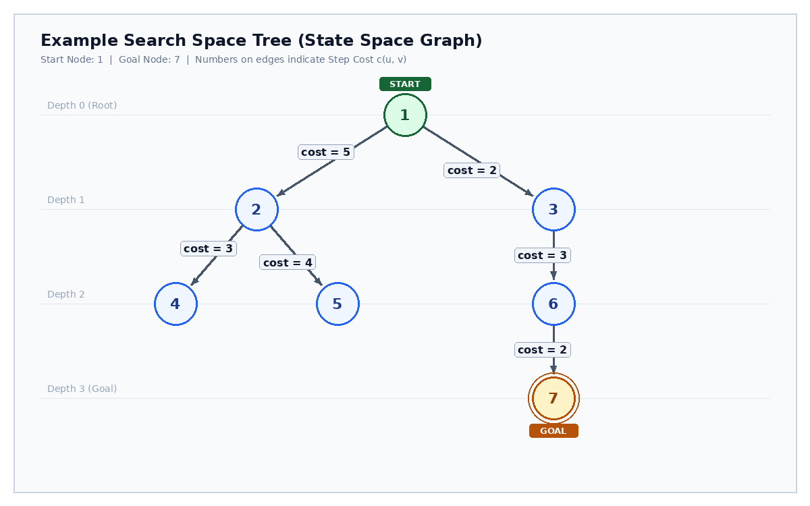

# কৃত্রিম বুদ্ধিমত্তা (Artificial Intelligence): আন-ইনফর্মড সার্চ অ্যালগরিদম কমপ্লিট এক্সাম গাইড
*CSE 3rd/4th Year Semester Final & Competitive Exam Standard | Full Step-by-Step Trace Tables & Complexity Analysis*

---

## ভূমিকা ও সারসংক্ষেপ
আন-ইনফর্মড সার্চ (Uninformed / Blind Search) অ্যালগরিদমগুলোতে লক্ষ্য (Goal) সম্পর্কে কোনো ডোমেইন জ্ঞান বা হিউরিস্টিক (Heuristic) তথ্য থাকে না। অ্যালগরিদমগুলো শুধুমাত্র সমস্যার স্টেট-স্পেস গ্রাফ ও ট্রাভার্সাল রুল ব্যবহার করে লক্ষ্য নোড খুঁজে বের করে। এই গাইডে ক্লাসিক্যাল ৬টি সার্চ অ্যালগরিদমের মেমোরি ডেটা স্ট্রাকচার, ফ্রিঞ্জ/স্ট্যাক/কিউ স্ট্যাটাস এবং পরীক্ষার খাতায় শতভাগ নম্বর পাওয়ার উপযোগী নিখুঁত ট্রেস টেবিল উপস্থাপন করা হলো।

---

## ১. স্টেট স্পেস গ্রাফ মডেল (Search Space Graph Representation)

পরীক্ষায় অ্যালগরিদমের কার্যপ্রণালী ও পার্থক্য স্পষ্ট করার জন্য নিচের ৭-নোড বিশিষ্ট গ্রাফটি আদর্শ উদাহরণ হিসেবে নেওয়া হলো। এখানে প্রতিটি এজের পাশে নির্দিষ্ট ট্রাভেল কস্ট (Step Cost) দেওয়া হয়েছে, যাতে **Uniform-Cost Search (UCS)**-এর আসল বৈশিষ্ট্য সাধারণ BFS থেকে স্পষ্টভাবে আলাদাভাবে দেখা যায়।

### গ্রাফের স্পেসিফিকেশন:
* **নোড সেট (Nodes):** $V = \{1, 2, 3, 4, 5, 6, 7\}$
* **স্টার্ট নোড (Start State):** নোড $1$ (Depth 0)
* **গোল নোড (Goal State):** নোড $7$ (Depth 3)
* **এজ ও স্টেপ কস্ট $c(u, v)$:**
  * $1 \to 2$ (কস্ট = $5$)
  * $1 \to 3$ (কস্ট = $2$)
  * $2 \to 4$ (কস্ট = $3$)
  * $2 \to 5$ (কস্ট = $4$)
  * $3 \to 6$ (কস্ট = $3$)
  * $6 \to 7$ (কস্ট = $2$)
* **টাই-ব্রেকিং নীতি (Tie-breaking rule):** যদি ফ্রন্টিয়ারে একাধিক নোডের অগ্রাধিকার একই হয়, তবে ছোট নোড আইডি (বাম দিকের নোড) আগে এক্সপ্যান্ড হবে।

---

## ২. Breadth-First Search (BFS)

BFS হলো লেভেল-বাই-লেভেল ট্রাভার্সাল অ্যালগরিদম। এটি রুট থেকে শুরু করে প্রতিটি ডেপথের সকল নোডকে ক্রমান্বয়ে এক্সপ্লোর করে পরবর্তী ডেপথে প্রবেশ করে।
* **ব্যবহৃত ডেটা স্ট্রাকচার:** FIFO Queue (First In First Out)।
* **গোল টেস্ট (Goal Test):** স্ট্যান্ডার্ড থিওরিতে (Russell & Norvig) নোড জেনারেশনের সময়ই গোল টেস্ট করা যায়, তবে পরীক্ষার খাতায় টেবিল প্রদর্শনের ক্ষেত্রে এক্সপানশনের সময় দেখানো হয়।
* **ট্রেসিং নিয়ম:** Queue-এর বাম পাশ Front (পপ হবে) এবং ডান পাশ Rear (নতুন চাইল্ড পুশ হবে)।

### BFS স্টেপ-বাই-স্টেপ ট্রেস টেবিল:

| Step | Expanded Node | Generated Children | Queue State (Front $\to$ Rear) | Visited / Closed Set | Goal Check? |
| :---: | :---: | :---: | :---: | :---: | :---: |
| **Init** | - | - | `[1]` | $\emptyset$ | No |
| **১** | **1** | 2, 3 | `[2, 3]` | $\{1\}$ | No |
| **২** | **2** | 4, 5 | `[3, 4, 5]` | $\{1, 2\}$ | No |
| **৩** | **3** | 6 | `[4, 5, 6]` | $\{1, 2, 3\}$ | No |
| **৪** | **4** | None | `[5, 6]` | $\{1, 2, 3, 4\}$ | No |
| **৫** | **5** | None | `[6]` | $\{1, 2, 3, 4, 5\}$ | No |
| **৬** | **6** | 7 | `[7]` | $\{1, 2, 3, 4, 5, 6\}$ | No |
| **৭** | **7** | None | `[] (Empty)` | $\{1, 2, 3, 4, 5, 6, 7\}$ | **Goal Found! STOP** |

### ফলাফল ও তাত্ত্বিক বিশ্লেষণ:
* **নোড এক্সপানশন ক্রম (Traversal Order):** $1 \to 2 \to 3 \to 4 \to 5 \to 6 \to 7$
* **প্রাপ্ত পাথ (Solution Path):** $1 \to 3 \to 6 \to 7$ (পাথ লেন্থ = ৩ স্টেপ, মোট কস্ট = $2 + 3 + 2 = 7$)
* **টাইম কমপ্লেক্সিটি:** $O(b^d)$
* **স্পেস কমপ্লেক্সিটি:** $O(b^d)$ (মেমোরি ড্রব্যাক)
* **কমপ্লিটনেস:** হ্যাঁ (যদি ব্রাঞ্চিং ফ্যাক্টর $b$ সসীম হয়)
* **অপটিমালিটি:** হ্যাঁ (যদি প্রতিটি এজের কস্ট সমান হয়)। নন-ইউনিফর্ম কস্টে BFS অপটিমাল পাথ গ্যারান্টি দেয় না।

---

## ৩. Depth-First Search (DFS)

DFS একটি নির্দিষ্ট শাখার একদম শেষ নোড (গভীরে) পর্যন্ত এক্সপ্লোর করে এবং ডেড-এন্ডে পৌঁছালে পেছনে ব্যাকট্র্যাক করে পরবর্তী শাখায় যায়।
* **ব্যবহৃত ডেটা স্ট্রাকচার:** LIFO Stack (Last In First Out)।
* **স্ট্যাক পুশ অর্ডার কৌশল:** বামদিকের নোডকে আগে ভিজিট করতে চাইলে স্ট্যাকে ডানদিকের চাইল্ড আগে এবং বাঁদিকের চাইল্ড পরে পুশ করতে হবে। নিচের টেবিলে স্ট্যাকের ডান প্রান্তকে 'Top' ধরা হয়েছে।

### DFS স্টেপ-বাই-স্টেপ ট্রেস টেবিল:

| Step | Popped Node | Children Generated | Stack State (Top is at Right) | Visited / Closed Set | Goal Check? |
| :---: | :---: | :---: | :---: | :---: | :---: |
| **Init** | - | - | `[1]` (Top=1) | $\emptyset$ | No |
| **১** | **1** | 2, 3 (পুশ: 3, 2) | `[3, 2]` (Top=2) | $\{1\}$ | No |
| **২** | **2** | 4, 5 (পুশ: 5, 4) | `[3, 5, 4]` (Top=4) | $\{1, 2\}$ | No |
| **৩** | **4** | None | `[3, 5]` (Top=5) | $\{1, 2, 4\}$ | No |
| **৪** | **5** | None | `[3]` (Top=3) | $\{1, 2, 4, 5\}$ | No |
| **৫** | **3** | 6 (পুশ: 6) | `[6]` (Top=6) | $\{1, 2, 4, 5, 3\}$ | No |
| **৬** | **6** | 7 (পুশ: 7) | `[7]` (Top=7) | $\{1, 2, 4, 5, 3, 6\}$ | No |
| **৭** | **7** | None | `[] (Empty)` | $\{1, 2, 4, 5, 3, 6, 7\}$ | **Goal Found! STOP** |

### ফলাফল ও তাত্ত্বিক বিশ্লেষণ:
* **নোড এক্সপানশন ক্রম:** $1 \to 2 \to 4 \to 5 \to 3 \to 6 \to 7$
* **প্রাপ্ত পাথ:** $1 \to 3 \to 6 \to 7$
* **টাইম কমপ্লেক্সিটি:** $O(b^m)$ (যেখানে $m$ = গ্রাফের সর্বোচ্চ গভীরতা)
* **স্পেস কমপ্লেক্সিটি:** $O(b \cdot m)$ (লিনিয়ার স্পেস কমপ্লেক্সিটি — অত্যন্ত কম মেমোরি লাগে!)
* **কমপ্লিটনেস:** না (ইনফিনিট ব্রাঞ্চ বা সাইকেল থাকলে আটকে যায়)
* **অপটিমালিটি:** না (যে পাথ আগে পায় সেটিই রিটার্ন করে, কম খরচের পাথ খোঁজে না)

---

## ৪. Uniform-Cost Search (UCS / Dijkstra's Algorithm)

UCS সর্বদা স্টার্ট নোড থেকে সর্বনিম্ন পুঞ্জীভূত পথ-খরচ (Cumulative Path Cost $g(n)$) বিশিষ্ট নোডকে অগ্রাধিকার দিয়ে সম্প্রসারিত করে।
* **ব্যবহৃত ডেটা স্ট্রাকচার:** Priority Queue (পাথ কস্ট $g(n)$ অনুযায়ী এসেন্ডিং অর্ডারে সাজানো)।
* **গোল টেস্টের অতি গুরুত্বপূর্ণ নিয়ম:** UCS-এ গোল টেস্ট অবশ্যই নোডটি প্রায়োরিটি কিউ থেকে **POP করার সময়** করতে হবে, জেনারেট হওয়ার সময় নয়! কারণ জেনারেশনের সময় কোনো গোল নোড বেশি কস্ট নিয়ে কিউতে ঢুকলেও পরে বিকল্প সস্তা পাথে আরও কম খরচে পৌঁছানো সম্ভব হতে পারে।

### UCS স্টেপ-বাই-স্টেপ ট্রেস টেবিল:

| Step | Popped Node & $g(n)$ | Generated Children with $g(n)$ | Priority Queue State `[(Node, g)]` | Visited Set | Goal Check? |
| :---: | :---: | :---: | :---: | :---: | :---: |
| **Init** | - | - | `[(1, g=0)]` | $\emptyset$ | No |
| **১** | **(1, g=0)** | 2: $g=0+5=5$, 3: $g=0+2=2$ | `[(3, 2), (2, 5)]` | $\{1\}$ | No |
| **২** | **(3, g=2)** | 6: $g=2+3=5$ | `[(2, 5), (6, 5)]` | $\{1, 3\}$ | No (কস্ট $2 < 5$) |
| **৩** | **(2, g=5)** | 4: $g=5+3=8$, 5: $g=5+4=9$ | `[(6, 5), (4, 8), (5, 9)]` | $\{1, 3, 2\}$ | No (টাই-ব্রেকার 2) |
| **৪** | **(6, g=5)** | 7: $g=5+2=7$ | `[(7, 7), (4, 8), (5, 9)]` | $\{1, 3, 2, 6\}$ | No |
| **৫** | **(7, g=7)** | None (Goal Node Popped) | `[(4, 8), (5, 9)]` | $\{1, 3, 2, 6, 7\}$ | **Goal Popped! STOP** |

### UCS এর বুদ্ধিমত্তা ও প্রুনিং (Pruning) পাওয়ার:
1. **প্রুনিং শক্তি:** দেখুন, নোড ৪ (কস্ট ৮) এবং নোড ৫ (কস্ট ৯) প্রায়োরিটি কিউতে থাকা সত্ত্বেও কখনোই **EXPAND হয়নি!** কারণ তাদের চেয়ে কম কস্টে (৭) গোল নোডটি কিউ থেকে পপ হয়ে গেছে।
2. **নোড এক্সপানশন ক্রম:** $1 \to 3 \to 2 \to 6 \to 7$ (BFS ও DFS থেকে সম্পূর্ণ আলাদা!)
3. **অপটিমাল পাথ:** $1 \to 3 \to 6 \to 7$ | মোট ন্যূনতম খরচ = **৭**
4. **টাইম ও স্পেস কমপ্লেক্সিটি:** $O(b^{1 + \lfloor C^* / \epsilon \rfloor})$ (যেখানে $C^*$ = অপটিমাল কস্ট, $\epsilon$ = ক্ষুদ্রতম এজ কস্ট)
5. **কমপ্লিটনেস ও অপটিমালিটি:** উভয়ই হ্যাঁ (যদি সকল এজের কস্ট $\epsilon > 0$ হয়)।

---

## ৫. Depth-Limited Search (DLS)

DLS হলো DFS-এর একটি পরিমার্জিত রূপ, যেখানে ইনফিনিট লুপের বিপদ এড়াতে একটি পূর্বনির্ধারিত গভীরতা সীমা (Depth Limit $l$) বেঁধে দেওয়া হয়। সীমার বাইরের কোনো চাইল্ড নোড তৈরি করা হয় না। গোল নোড ৭ রয়েছে Depth ৩-এ।
* **মূল বৈশিষ্ট্য:** যদি Limit $l < d$ (গোল গভীরতা) হয়, তবে সার্চ Cutoff Failure দেয়। আর যদি $l \ge d$ হয়, তবে সমাধান পাওয়া যায়।

### Limit $l = 2$ (ব্যর্থ) বনাম Limit $l = 3$ (সফল) তুলনামূলক ট্রেস টেবিল:

| Step | Expanded Node (Depth) | Limit $l = 2$ Action & Stack | Limit $l = 3$ Action & Stack | Goal Status & Remarks |
| :---: | :---: | :---: | :---: | :---: |
| **১** | **1 (d=0)** | Stack: `[3, 2]` ($d=1 \le 2$) | Stack: `[3, 2]` ($d=1 \le 3$) | উভয় ক্ষেত্রেই সীমার ভেতর |
| **২** | **2 (d=1)** | Stack: `[3, 5, 4]` ($d=2 \le 2$) | Stack: `[3, 5, 4]` ($d=2 \le 3$) | উভয় ক্ষেত্রেই সীমার ভেতর |
| **৩** | **4 (d=2)** | Limit ২ পৌঁছেছে! চাইল্ড যাবে না | Leaf Node (কোনো চাইল্ড নেই) | $l=2$ এর সীমা শেষ |
| **৪** | **5 (d=2)** | Limit ২ পৌঁছেছে! চাইল্ড যাবে না | Leaf Node (কোনো চাইল্ড নেই) | $l=2$ এর সীমা শেষ |
| **৫** | **3 (d=1)** | Stack: `[6]` ($d=2 \le 2$) | Stack: `[6]` ($d=2 \le 3$) | উভয় ক্ষেত্রেই সীমার ভেতর |
| **৬** | **6 (d=2)** | Limit ২ শেষ! চাইল্ড ৭ ($d=3$) বাদ! | Stack: `[7]` ($d=3 \le 3$ পুশ) | **মূল পার্থক্য! $l=2$ তে ৭ বাদ পড়েছে** |
| **৭** | **7 (d=3)** | Not Reached! (Cutoff Failure) | **Goal Node Popped! [SUCCESS]** | **$l=2$ ব্যর্থ, কিন্তু $l=3$ সফল!** |

### ফলাফল বিশ্লেষণ:
* **কেস ১ (Limit $l = 2$):** এক্সপানশন ক্রম: $1 \to 2 \to 4 \to 5 \to 3 \to 6$। ফলাফল: Cutoff Failure।
* **কেস ২ (Limit $l = 3$):** এক্সপানশন ক্রম: $1 \to 2 \to 4 \to 5 \to 3 \to 6 \to 7$। ফলাফল: Goal Found (Success)।
* **কমপ্লেক্সিটি:** টাইম = $O(b^l)$, স্পেস = $O(b \cdot l)$
* **কমপ্লিটনেস:** না (যদি $l < d$ হয়) | **অপটিমালিটি:** না (যদি $l > d$ হয় তবে সাব-অপটিমাল পাথ আগে পেতে পারে)।

---

## ৬. Iterative Deepening Search (IDS / IDDFS)

IDS হলো আন-ইনফর্মড সার্চের সবচেয়ে সুষম ও চমৎকার অ্যালগরিদম। এটি DFS-এর মেমোরি দক্ষতা (Linear Space) এবং BFS-এর কমপ্লিটনেস ও অপটিমালিটিকে একত্র করে। এটি ক্রমান্বয়ে Limit = $0, 1, 2, 3 \dots$ বাড়িয়ে DLS রান করে যতক্ষণ না গোল পাওয়া যায়।

### IDS ইটারেশন টেবিল:

| Iteration Limit | Depth Boundary | Nodes Expanded in this Iteration | Total Nodes Expanded | Status |
| :---: | :---: | :---: | :---: | :---: |
| **Limit = 0** | Depth 0 | 1 | 1 | Cutoff (Goal not found) |
| **Limit = 1** | Depth 0 থেকে 1 | $1 \to 2 \to 3$ | 3 | Cutoff (Goal not found) |
| **Limit = 2** | Depth 0 থেকে 2 | $1 \to 2 \to 4 \to 5 \to 3 \to 6$ | 6 | Cutoff (Goal not found) |
| **Limit = 3** | Depth 0 থেকে 3 | $1 \to 2 \to 4 \to 5 \to 3 \to 6 \to 7$ | 7 | **Goal 7 Found! SUCCESS** |

### IDS এর মেমোরি ও ওভারহেড সংক্রান্ত গাণিতিক ব্যাখ্যা (Exam Favorite):
* **সাধারণ ভুল ধারণা:** বারবার আগের লেভেল এক্সপ্যান্ড করায় IDS অনেক বেশি সময় নষ্ট করে।
* **গাণিতিক সত্য:** সার্চ ট্রির নোড সংখ্যা জ্যামিতিক হারে (Exponentially) বাড়ে। রুট নোড মাত্র $d$ বার তৈরি হয়, কিন্তু সবচেয়ে নিচের লেভেলের বিশাল সংখ্যক নোড তৈরি হয় মাত্র ১ বার।
$$\text{Total Expansion} = (d+1)\cdot 1 + d\cdot b + (d-1)\cdot b^2 + \dots + 1\cdot b^d = O(b^d)$$
* **টাইম কমপ্লেক্সিটি:** $O(b^d)$ (BFS-এর সমান)
* **স্পেস কমপ্লেক্সিটি:** $O(b \cdot d)$ (DFS-এর মতো ক্ষুদ্র! মেমোরি কখনো ক্র্যাশ করে না)।

---

## ৭. Bidirectional Search (BDS)

BDS একই সাথে দুটি সমান্তরাল সার্চ পরিচালনা করে: একটি স্টার্ট নোড থেকে সামনের দিকে (Forward Search), অন্যটি গোল নোড থেকে পেছনের দিকে (Backward Search)। যখন উভয়ের ফ্রন্টিয়ার কোনো সাধারণ নোডে মিলিত হয়, তখন একটি পূর্ণাঙ্গ পাথ গঠিত হয়।

### BDS স্টেপ-বাই-স্টেপ ট্রেস টেবিল:

| Direction | Current Expanded | Frontier Nodes (Queue State) | Intersection Check | Status |
| :---: | :---: | :---: | :---: | :---: |
| **Forward (Start: 1)** | 1 | $\{2, 3\}$ | Backward-এর সাথে কোনো মিল নেই | In Progress |
| **Backward (Goal: 7)** | 7 (Predecessor: 6) | $\{6\}$ | Forward-এর সাথে কোনো মিল নেই | In Progress |
| **Forward** | 3 (চাইল্ড: 6) | $\{2, 6\}$ | **উভয়ের ফ্রন্টিয়ারে নোড 6 বর্তমান!** | **Intersection at Node 6!** |
| **Path Construction** | Forward: $1 \to 3 \to 6$ | Backward: $6 \to 7$ | **পূর্ণাঙ্গ পাথ: $1 \to 3 \to 6 \to 7$** | **Search Completed!** |

### কার্যকারিতা ও সীমাবদ্ধতা:
* **গাণিতিক সুবিধা:** $O(b^d)$ এর পরিবর্তে টাইম কমপ্লেক্সিটি দাঁড়ায় $O(2 \cdot b^{d/2}) = O(b^{d/2})$। যেমন: $b=10$ এবং $d=6$ হলে ট্র্যাডিশনাল সার্চে $10^6 = 10,00,000$ নোড এক্সপ্যান্ড হতো, যেখানে BDS-এ মাত্র $2 \times 10^3 = 2,000$ নোড এক্সপ্যান্ড হবে!
* **প্রধান সীমাবদ্ধতা:** পেছনের দিকে সার্চ করার জন্য গোল স্টেট সুনির্দিষ্ট ও অনন্য হতে হয় এবং প্রতিটি এজের বিপরীতমুখী পথ (Predecessor) জানা থাকা আবশ্যক।

---

## ৮. সার্বিক তুলনামূলক ম্যাট্রিক্স (Uninformed Search Master Matrix)

বিশ্ববিদ্যালয় ফাইনাল পরীক্ষার খাতায় নিচের ছকটি হুবহু লিখলে সর্বোচ্চ পূর্ণ নম্বর নিশ্চিত করা যায়:

| Algorithm | Data Structure | Time Complexity | Space Complexity | Complete? | Optimal? |
| :--- | :--- | :--- | :--- | :---: | :---: |
| **BFS** | FIFO Queue | $O(b^d)$ | $O(b^d)$ | Yes (যদি $b$ সসীম) | Yes (যদি কস্ট সমান) |
| **DFS** | LIFO Stack | $O(b^m)$ | $O(b \cdot m)$ | No (লুপ থাকলে আটকে যায়) | No |
| **UCS** | Priority Queue | $O(b^{1 + \lfloor C^* / \epsilon \rfloor})$ | $O(b^{1 + \lfloor C^* / \epsilon \rfloor})$ | Yes (যদি কস্ট $> 0$) | Yes (সর্বদা কস্ট-অপটিমাল) |
| **DLS** | Stack + Limit $l$ | $O(b^l)$ | $O(b \cdot l)$ | No (যদি $l < d$) | No |
| **IDS** | Iterative Stack | $O(b^d)$ | $O(b \cdot d)$ | Yes (যদি $b$ সসীম) | Yes (যদি কস্ট সমান) |
| **BDS** | Two Queues | $O(b^{d/2})$ | $O(b^{d/2})$ | Yes (যদি $b$ সসীম) | Yes (যদি কস্ট সমান) |

---

## ৯. পরীক্ষার হলের বিশেষ সতর্কতা ও ফুল মার্কস সিক্রেট (Exam Survival Tips)

> [!CAUTION] পরীক্ষার খাতায় যেসব ভুলের কারণে নম্বর কাটা যায়:
> 1. **UCS-এ গোল টেস্ট জেনারেশনে দেখানো:** এটি AI পরীক্ষার এক নম্বর কমন ভুল। UCS-এ কোনো নোড জেনারেট হওয়ার সাথে সাথে গোল বলা যাবে না; নোডটি যখন সর্বনিম্ন খরচের হিসেবে পপ (Pop) হবে তখনই কেবল গোল ঘোষণা করতে হবে।
> 2. **স্ট্যাকের Top কোন দিকে তা উল্লেখ না করা:** DFS ও DLS লেখার সময় স্ট্যাকের কোন দিকটা Top (বাম না ডান) তা টেবিলে বা নোট আকারে অবশ্যই লিখে দিতে হবে।
> 3. **ট্রি সার্চ বনাম গ্রাফ সার্চ গুলিয়ে ফেলা:** গ্রাফে যদি সাইকেল থাকে, তবে Visited Set / Closed List বজায় না রাখলে DFS ও BFS উভয়ই অনন্ত লুপে আটকাতে পারে। তাই Visited Set কলাম প্রদর্শন করা অত্যন্ত জরুরি।
> 4. **IDS-এর স্পেস কমপ্লেক্সিটি নিয়ে ভুল ধারণা:** IDS-এর স্পেস কখনোই $O(b^d)$ নয়, এটি $O(b \cdot d)$; কারণ এটি যেকোনো মুহূর্তে শুধুমাত্র একটি শাখার নোডই মেমোরিতে রাখে।
