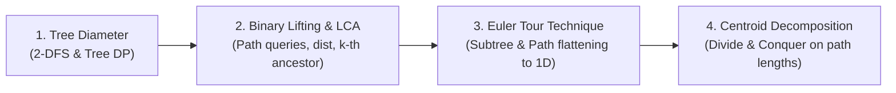

# Tree Algorithms Mastery: LCA, Tree Diameter, Euler Tour & Centroid Decomposition
> **Curated Core-Building Problemset & Competitive Programming Reference**  
> Specially designed for **ICPC Dhaka Preliminary, Regional Onsite & IUPC Contests**.

---

## Table of Contents
1. [Core Learning Path & Prerequisites](#1-core-learning-path--prerequisites)
2. [Pillar 1: Tree Diameter & Longest Paths](#2-pillar-1-tree-diameter--longest-paths)
   - [Theory & Invariants](#tree-diameter-theory)
   - [C++20 Implementation Templates](#tree-diameter-template)
   - [Curated Practice Ladder](#tree-diameter-problems)
3. [Pillar 2: Lowest Common Ancestor (LCA) via Binary Lifting](#3-pillar-2-lowest-common-ancestor-lca-via-binary-lifting)
   - [Theory & Invariants](#lca-theory)
   - [C++20 Implementation Template](#lca-template)
   - [Curated Practice Ladder](#lca-problems)
4. [Pillar 3: Euler Tour Technique (Flattening Trees)](#4-pillar-3-euler-tour-technique-flattening-trees)
   - [Theory & Invariants](#euler-tour-theory)
   - [C++20 Implementation Template](#euler-tour-template)
   - [Curated Practice Ladder](#euler-tour-problems)
5. [Pillar 4: Centroid Decomposition (Divide & Conquer on Trees)](#5-pillar-4-centroid-decomposition-divide--conquer-on-trees)
   - [Theory & Invariants](#centroid-theory)
   - [C++20 Implementation Template](#centroid-template)
   - [Curated Practice Ladder](#centroid-problems)
6. [Master Problem Solving Schedule & Checklist](#6-master-problem-solving-schedule--checklist)

---

## 1. Core Learning Path & Prerequisites

Trees account for **over 15% of all contest problems** in Bangladeshi programming contests (52 out of 343 problems in 2021–2026). Mastering these four pillars forms the essential backbone for ICPC:



---

## 2. Pillar 1: Tree Diameter & Longest Paths

### <a id="tree-diameter-theory"></a>Theory & Invariants
The diameter of a tree is the length of the longest simple path between any pair of nodes.
- **Method 1: Two DFS / BFS runs ($O(N)$):**
  1. Run DFS from an arbitrary node (e.g. node `1`) to find the farthest node $U$.
  2. Run a second DFS from node $U$ to find the farthest node $V$.
  3. The distance $dist(U, V)$ is the diameter. The path between $U$ and $V$ is the diameter path.
  *Note:* Only valid for non-negative edge weights.
- **Method 2: Tree Dynamic Programming ($O(N)$):**
  1. Let $dp[u]$ be the longest downward path from $u$ to a leaf in its subtree.
  2. For node $u$, the longest path turning at $u$ is the sum of the two largest downward branches + their edge weights: $\max(dp[v_1] + dp[v_2] + w_1 + w_2)$.
  *Note:* Works with negative edge weights as well.

### <a id="tree-diameter-template"></a>C++20 Implementation Templates

#### Two-DFS Method
```cpp
#include <bits/stdc++.h>
using namespace std;

const int MAXN = 200005;
vector<pair<int, long long>> adj[MAXN];
long long dist_node[MAXN];

void dfs(int u, int p, long long d, int &farthest_node) {
    dist_node[u] = d;
    if (dist_node[u] > dist_node[farthest_node]) {
        farthest_node = u;
    }
    for (auto &[v, w] : adj[u]) {
        if (v != p) dfs(v, u, d + w, farthest_node);
    }
}

// Returns {diameter_length, {endpoint_u, endpoint_v}}
pair<long long, pair<int, int>> get_tree_diameter(int n) {
    int u = 1;
    dfs(1, 0, 0, u);
    int v = u;
    dfs(u, 0, 0, v);
    return {dist_node[v], {u, v}};
}
```

#### Tree DP Method (Handles Negative Weights & Midpoint Centering)
```cpp
long long max_diameter = 0;
long long down_depth[MAXN];

void dfs_dp(int u, int p) {
    down_depth[u] = 0;
    long long max1 = 0, max2 = 0;
    for (auto &[v, w] : adj[u]) {
        if (v == p) continue;
        dfs_dp(v, u);
        long long branch = down_depth[v] + w;
        if (branch > max1) {
            max2 = max1; max1 = branch;
        } else if (branch > max2) {
            max2 = branch;
        }
    }
    down_depth[u] = max1;
    max_diameter = max(max_diameter, max1 + max2);
}
```

### <a id="tree-diameter-problems"></a>Curated Practice Ladder

| Problem | Platform | Difficulty | Core Concept & Why to Solve |
| :--- | :---: | :---: | :--- |
| **1. [Tree Diameter](https://cses.fi/problemset/task/1131)** | CSES 1131 | Easy | Direct baseline: Implement both 2-DFS and Tree DP to verify your template. |
| **2. [Longest path in a tree](https://www.spoj.com/problems/PT07Z/)** | SPOJ PT07Z | Easy | Classic verification problem on 0/1 unweighted trees. |
| **3. [Tree Tag](https://codeforces.com/problemset/problem/1404/B)** | CF 1404B | Medium | Combines Tree Diameter with Game Theory. If player B's jump distance $2 \cdot d_a \ge 	ext{diameter}$, escape is impossible. |
| **4. [Civilization](https://codeforces.com/problemset/problem/455/C)** | CF 455C | Medium-Hard | Maintain connected component diameters while dynamically merging trees via DSU. When connecting two trees with diameters $D_1$ and $D_2$, new diameter is $\max(D_1, D_2, \lceil D_1/2 
ceil + \lceil D_2/2 
ceil + 1)$. |
| **5. [Flowers](file:///home/shohan241/Downloads/IUPC-ICPC_Problemset/2024%20ICPC%20Dhaka%20Regional%20Problemset.pdf)** | ICPC Dhaka Reg 2024 (Prob F) | Hard | Forest diameter optimization and dynamic tree bridging. |

---

## 3. Pillar 2: Lowest Common Ancestor (LCA) via Binary Lifting

### <a id="lca-theory"></a>Theory & Invariants
- Precompute table `up[u][k]` storing the $2^k$-th ancestor of node $u$.
  - Recurrence: `up[u][k] = up[ up[u][k-1] ][k-1]`
  - Base case: `up[u][0] = parent[u]`
- **Precomputation Time:** $O(N \log N)$
- **Queries in $O(\log N)$:**
  1. **$K$-th Ancestor:** Jump through powers of 2 matching the binary bits of $K$.
  2. **LCA of $u$ and $v$:**
     - Lift the deeper node until `depth[u] == depth[v]`.
     - If $u == v$, return $u$.
     - Simultaneously lift $u$ and $v$ from $k = \log N$ down to $0$ whenever `up[u][k] != up[v][k]`.
     - The answer is `up[u][0]`.
  3. **Path Distance:** $dist(u, v) = depth[u] + depth[v] - 2 \cdot depth[LCA(u, v)]$.
  4. **Path Minimum/Maximum/XOR:** Precompute `max_edge[u][k]` identically: `max(max_edge[u][k-1], max_edge[up[u][k-1]][k-1])`.

### <a id="lca-template"></a>C++20 Implementation Template
```cpp
#include <bits/stdc++.h>
using namespace std;

const int MAXN = 200005;
const int LOGN = 20;

vector<int> adj[MAXN];
int up[MAXN][LOGN];
int depth_node[MAXN];

void dfs_lca(int u, int p, int d) {
    depth_node[u] = d;
    up[u][0] = p;
    for (int k = 1; k < LOGN; ++k) {
        up[u][k] = up[up[u][k - 1]][k - 1];
    }
    for (int v : adj[u]) {
        if (v != p) dfs_lca(v, u, d + 1);
    }
}

int get_kth_ancestor(int u, int k) {
    for (int i = 0; i < LOGN; ++i) {
        if ((k >> i) & 1) {
            u = up[u][i];
            if (u == 0) break;
        }
    }
    return u;
}

int get_lca(int u, int v) {
    if (depth_node[u] < depth_node[v]) swap(u, v);
    // 1. Equalize depths
    for (int k = LOGN - 1; k >= 0; --k) {
        if (depth_node[u] - (1 << k) >= depth_node[v]) {
            u = up[u][k];
        }
    }
    if (u == v) return u;
    // 2. Binary lift both nodes
    for (int k = LOGN - 1; k >= 0; --k) {
        if (up[u][k] != up[v][k]) {
            u = up[u][k];
            v = up[v][k];
        }
    }
    return up[u][0];
}

int get_dist(int u, int v) {
    return depth_node[u] + depth_node[v] - 2 * depth_node[get_lca(u, v)];
}
```

### <a id="lca-problems"></a>Curated Practice Ladder

| Problem | Platform | Difficulty | Core Concept & Why to Solve |
| :--- | :---: | :---: | :--- |
| **1. [Company Queries I](https://cses.fi/problemset/task/1687)** | CSES 1687 | Easy | Basic $K$-th ancestor query via binary lifting. |
| **2. [Company Queries II](https://cses.fi/problemset/task/1688)** | CSES 1688 | Easy | Clean LCA template verification. |
| **3. [Distance Queries](https://cses.fi/problemset/task/1135)** | CSES 1135 | Easy-Medium | Tree path distance calculation via $depth[u] + depth[v] - 2 \cdot depth[lca]$. |
| **4. [Distance Query](https://www.spoj.com/problems/DISQUERY/)** | SPOJ DISQUERY | Medium | Extend `up[u][k]` to maintain `min_edge[u][k]` and `max_edge[u][k]` along tree paths. |
| **5. [Blood Cousins](https://codeforces.com/problemset/problem/208/E)** | CF 208E | Medium-Hard | Find $p$-th ancestor via binary lifting, then query how many nodes have that ancestor at the same depth (binary search on depth lists or Small-to-Large). |
| **6. [A and B and Lecture Rooms](https://codeforces.com/problemset/problem/519/E)** | CF 519E | Medium-Hard | Find midpoint of path between $u$ and $v$ using binary lifting, then compute subtree sizes. |
| **7. [Least Compatible Ancestor](file:///home/shohan241/Downloads/IUPC-ICPC_Problemset/2025%20ICPC%20Dhaka%20Preliminary%20Problemset.pdf)** | ICPC Dhaka Prelim 2025 (Prob C) | Medium | Tree LCA and ancestry query variants in official Dhaka Preliminary contest. |

---

## 4. Pillar 3: Euler Tour Technique (Flattening Trees)

### <a id="euler-tour-theory"></a>Theory & Invariants
DFS entry time (`tin[u]`) and exit time (`tout[u]`) flatten a 2D hierarchical tree into a contiguous 1D array.
- **Subtree Invariant:** Node $v$ is in the subtree of $u \iff tin[u] \le tin[v] \le tout[u]$.
- **Subtree Queries:** The entire subtree of $u$ corresponds to the 1D range `[tin[u], tout[u]]`. Any subtree update or query reduces to a standard 1D range operation on a Segment Tree or Fenwick Tree.
- **Root-to-Node Path Queries:**
  - Place $+val[u]$ at `tin[u]` and $-val[u]$ at `tout[u] + 1`.
  - The path sum from root to $u$ equals the prefix sum up to $tin[u]$ in the Fenwick Tree.

### <a id="euler-tour-template"></a>C++20 Implementation Template
```cpp
#include <bits/stdc++.h>
using namespace std;

const int MAXN = 200005;
vector<int> adj[MAXN];
int tin[MAXN], tout[MAXN], flat_order[MAXN], timer = 0;

void dfs_euler(int u, int p) {
    tin[u] = ++timer;
    flat_order[timer] = u;
    for (int v : adj[u]) {
        if (v != p) dfs_euler(v, u);
    }
    tout[u] = timer;
}

// Subtree of u is [tin[u], tout[u]]
// Checks if u is ancestor of v in O(1)
bool is_ancestor(int u, int v) {
    return tin[u] <= tin[v] && tout[u] >= tout[v];
}
```

### <a id="euler-tour-problems"></a>Curated Practice Ladder

| Problem | Platform | Difficulty | Core Concept & Why to Solve |
| :--- | :---: | :---: | :--- |
| **1. [Subtree Queries](https://cses.fi/problemset/task/1137)** | CSES 1137 | Medium | Essential benchmark: Subtree value updates and subtree sums via Euler Tour + Fenwick. |
| **2. [Path Queries](https://cses.fi/problemset/task/1138)** | CSES 1138 | Medium | Root-to-node path queries using signed $+w$ and $-w$ on entry/exit. |
| **3. [New Year Tree](https://codeforces.com/problemset/problem/620/E)** | CF 620E | Medium-Hard | Color assignment on subtrees. Flatten tree and use Segment Tree with Lazy Propagation storing bitmasks of up to 60 colors. |
| **4. [Propagating Tree](https://codeforces.com/problemset/problem/383/C)** | CF 383C | Medium-Hard | Value $+x$ added to $u$ adds $-x$ to children at alternating depths. Split Euler tour into even-depth and odd-depth Fenwick trees. |
| **5. [Dominant Indices](https://codeforces.com/problemset/problem/1009/F)** | CF 1009F | Hard | Subtree depth frequency queries solved via DSU on Tree (Sack) or flattened tree. |
| **6. [Where is the Ghost](file:///home/shohan241/Downloads/IUPC-ICPC_Problemset/IUPC%202023%20CoU.pdf)** | IUPC 2023 CoU (Prob A) | Medium | Tree ancestry and reachability queries via entry/exit times. |

---

## 5. Pillar 4: Centroid Decomposition (Divide & Conquer on Trees)

### <a id="centroid-theory"></a>Theory & Invariants
- **Definition of Centroid:** A node $C$ whose removal partitions the tree into components, each having size at most $\lfloor N/2 
floor$. Every tree has at least one centroid (and at most two).
- **Centroid Tree Depth:** Since tree size is halved at each decomposition step, the maximum depth of the centroid tree is $\le \lfloor \log_2 N 
floor + 1$.
- **Path Divide-and-Conquer Principle:** Any path between two vertices in a tree either:
  1. **Passes through the centroid $C$:** (Path = $u 	o C 	o v$ where $u$ and $v$ belong to different subtrees of $C$).
  2. **Does not pass through $C$:** Entirely contained in one of the partitioned components (solved recursively).
- **Complexity:** $O(N \log N)$ or $O(N \log^2 N)$ depending on how path combinations through $C$ are counted.

### <a id="centroid-template"></a>C++20 Implementation Template
```cpp
#include <bits/stdc++.h>
using namespace std;

const int MAXN = 200005;
vector<int> adj[MAXN];
bool removed_centroid[MAXN];
int sz[MAXN];

// Step 1: Calculate component subtree sizes
int get_subtree_size(int u, int p) {
    sz[u] = 1;
    for (int v : adj[u]) {
        if (v != p && !removed_centroid[v]) {
            sz[u] += get_subtree_size(v, u);
        }
    }
    return sz[u];
}

// Step 2: Find centroid node
int get_centroid(int u, int p, int total_sz) {
    for (int v : adj[u]) {
        if (v != p && !removed_centroid[v]) {
            if (sz[v] > total_sz / 2) {
                return get_centroid(v, u, total_sz);
            }
        }
    }
    return u;
}

// Step 3: Decompose tree recursively
void decompose(int u, int p_centroid = 0) {
    int total_sz = get_subtree_size(u, 0);
    int c = get_centroid(u, 0, total_sz);
    
    // --- CONQUER: Process all paths passing through centroid 'c' ---
    // (Collect distances from c into subtrees, count valid pairs)
    
    removed_centroid[c] = true;
    for (int v : adj[c]) {
        if (!removed_centroid[v]) {
            decompose(v, c);
        }
    }
}
```

### <a id="centroid-problems"></a>Curated Practice Ladder

| Problem | Platform | Difficulty | Core Concept & Why to Solve |
| :--- | :---: | :---: | :--- |
| **1. [Ciel the Commander](https://codeforces.com/problemset/problem/321/C)** | CF 321C | Medium | Pure Centroid Tree building. Assign rank 'A' to root centroid, 'B' to depth-1 centroids, up to 'Z'. Proves centroid tree depth $\le 26$. |
| **2. [Query on a tree V](https://www.spoj.com/problems/QTREE5/)** | SPOJ QTREE5 | Medium-Hard | Classic Centroid Tree application: Toggle node white/black; query distance to nearest white node by walking up $O(\log N)$ centroid ancestors. |
| **3. [Distance in Tree](https://codeforces.com/problemset/problem/161/D)** | CF 161D | Medium-Hard | Count pairs of vertices with path distance exactly $K$. Solve with Centroid Decomposition to master path counting through the root centroid. |
| **4. [Close Vertices](https://codeforces.com/problemset/problem/293/E)** | CF 293E | Hard | Paths satisfying two bounds: edge count $\le L$ and total weight $\le W$. Solved using Centroid Decomposition + Fenwick Tree / Two Pointers. |
| **5. [Holy Tree](file:///home/shohan241/Downloads/IUPC-ICPC_Problemset/IUPC%202023%20SUST.pdf)** | IUPC 2023 SUST (Prob C) | Hard | Tree path and sacred node distance optimization. |
| **6. [Strong Tree](file:///home/shohan241/Downloads/IUPC-ICPC_Problemset/IUPC%202025%20AUST.pdf)** | IUPC 2025 AUST (Prob D) | Hard | Centroid decomposition combined with subtree aggregations. |

---

## 6. Master Problem Solving Schedule & Checklist

A structured 3-week study schedule to cement these concepts:

| Week | Target Topic | Target Problems | Milestone Goal |
| :---: | :--- | :--- | :--- |
| **Week 1** | **Tree Diameter & LCA** | CSES 1131, SPOJ PT07Z, CF 1404B, CSES 1687, CSES 1688, CSES 1135 | Code binary lifting bug-free in $< 10$ mins; calculate tree diameter in $< 5$ mins. |
| **Week 2** | **Euler Tour & Path Queries** | CSES 1137, CSES 1138, CF 620E, CF 383C, SPOJ DISQUERY, CF 208E | Flatten trees comfortably; combine Euler Tour with Fenwick & Lazy Segment Trees. |
| **Week 3** | **Centroid Decomposition** | CF 321C, SPOJ QTREE5, CF 161D, CF 293E, IUPC 2023 SUST C | Master centroid tree construction; conquer tree path counting in $O(N \log N)$. |

### Contest Checklist
- [ ] Pre-tested `LCA_BinaryLifting.cpp` in team notebook.
- [ ] Pre-tested `EulerTour_Fenwick.cpp` in team notebook.
- [ ] Pre-tested `CentroidDecomposition.cpp` in team notebook.
